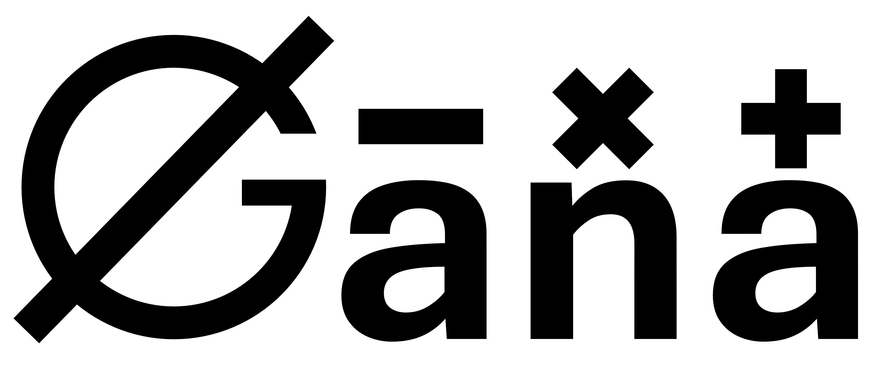

Gana Algebraic Modeling Language
================================

.. Use local theme-aware banners; skip the README's light-only HTML banner.

.. include:: ../README.md
   :parser: myst_parser.sphinx_
   :start-after: 

   

.. seealso::

   `Energia <https://energiapy.readthedocs.io/en/latest/>`_, a Data-Driven Multiscale 
   Modeling and Optimization Framework which uses Gana as the AML backend.

.. toctree::
   :maxdepth: 1
   :caption: Tutorials:
   :hidden:

   tutorials/installation
   tutorials/elements
   tutorials/indices 
   tutorials/parameters
   tutorials/variables
   tutorials/thetas
   tutorials/import_solution

.. toctree::
   :maxdepth: 1
   :caption: Interactive Examples
   :hidden:

   examples/diet 
   examples/machine
   examples/batch
   examples/energy
   examples/transport

.. toctree::
   :maxdepth: 1
   :caption: Information
   :hidden:

   license
   changelog

.. toctree::
   :maxdepth: 1
   :caption: Development and validation
   :hidden:

   NATIVE_BACKEND
   PUBLISHING_1_1_0
   QUALITY_BASELINE
   QUALITY_GATES
   REPRODUCIBLE_BASELINE
   TYPE_ALIASES
   

API Reference
=============

.. autosummary:: 
   :toctree: _autosummary
   :recursive:
   :caption: API
   :nosignatures:

   gana
   gana.block
   gana.operators
   gana.sets
   gana.shapes
   gana.utils
   gana.value
   gana.types
   gana.backends
   gana.indexing
   gana.storage
   gana.storage.members
   gana.storage.parameters
   gana.storage.symbols

Indices and tables
==================

* :ref:`genindex`
* :ref:`modindex`
* :ref:`search`

