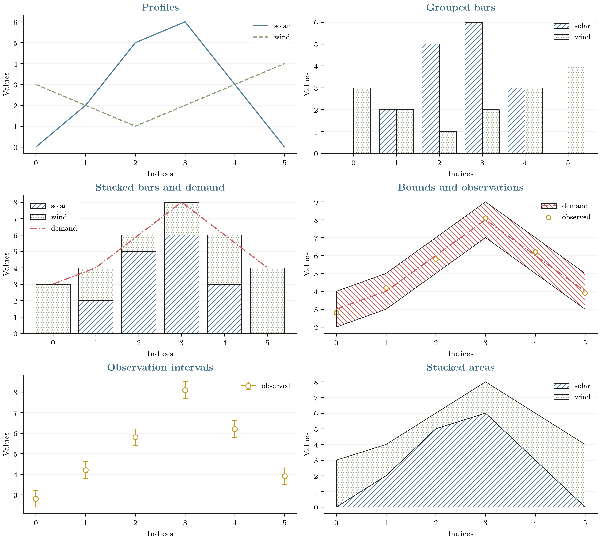

Plotting
========

Parameters and variables return reusable plot descriptions. A program accepts
several quantities with shared options. ``+`` combines descriptions on the same
axes, including different chart types. Construction does not display a figure.

.. code-block:: python

   from gana import I, P, Prg

   p = Prg()
   p.time = I(size=4)
   p.production = P(p.time, _=[2, 4, 5, 3])
   p.imports = P(p.time, _=[1, 1, 0, 2])
   p.demand = P(p.time, _=[3, 5, 5, 5])

   plot = p.stacked(p.production, p.imports) + p.demand.line()
   plot.show()
   plot.save("supply.pdf", profile="print", fig_size=(3.5, 2.5))

``p.stacked(...)`` is equivalent to ``p.bar(..., kind="stacked")``. With
matching options, ``p.production.bar() + p.bar(p.imports)`` produces the same
bars as ``p.bar(p.production, p.imports)``. Multiple bars are grouped by default.
Positive and negative contributions stack separately from zero. A missing
contribution leaves the cumulative total unavailable at that coordinate.

Chart methods
-------------

The following methods are available on parameters, variables and programs.
The functions in :mod:`gana.plotting` also accept one-dimensional numerical
sequences, so downstream packages can render data without creating a model.

.. list-table::
   :header-rows: 1
   :widths: 25 75

   * - Method
     - Meaning
   * - ``line``
     - Profiles; ``step="pre"``, ``"post"`` or ``"mid"`` draws steps.
   * - ``scatter``
     - Observations; ``x=p.cost`` can plot values against another quantity.
   * - ``bar`` / ``stacked``
     - Simple, grouped or signed stacked bars; ``kind`` chooses the arrangement.
   * - ``band``
     - Explicit ``lower`` and ``upper`` bounds. Add a line for the central curve.
   * - ``errorbar``
     - ``xerr`` and/or ``yerr`` deviations, including asymmetric 2-by-N arrays.
   * - ``area``
     - Patterned area profiles; ``kind="stacked"`` combines contributions.

.. code-block:: python

   from gana.plotting import band, line, scatter

   prediction = [2, 3, 4]
   interval = band(prediction, lower=[1, 2, 3], upper=[3, 4, 5])
   plot = interval + line(prediction) + scatter([2.2, 2.8, 4.1])
   result = plot.render()
   figure, axes, plotted_data = result.figure, result.axes, result.data

Bounds are supplied data, not statistical estimates. All quantities retain
zero and missing values distinctly. Plotting does not solve, aggregate,
interpolate or evaluate model expressions. Numerical values and coordinates
are captured when the description is constructed.

Indices and solutions
---------------------

Index roles are assigned from right to left. For ``v[z, y, x]``, the final
index supplies the horizontal coordinate, the preceding index supplies
series, and the third-last index supplies panels. Values supply the vertical
coordinate. Thus a final time index remains horizontal.

Use ``x``, ``series`` and ``panel`` to override these roles with index objects
or dimension positions. Select any additional varying dimensions using Gana's
ordinary selection interface before plotting. ``False`` disables an optional
series/panel role when that dimension is fixed. Panel order follows the source.

.. code-block:: python

   p.scenario = I("low", "high")
   p.profile = P(p.scenario, p.time, _=[1, 2, 3, 2, 2, 4, 5, 3])
   p.profile.line().show()
   p.profile.line(x=p.scenario, series=p.time).show()
   p.profile(p.low, p.time).line().show()

Variables use stored solution number ``0`` by default, preserving the existing
selection convention. Pass ``n_sol=1`` to select another solution explicitly.
An unavailable solution raises ``ValueError``; omitted columns remain missing.
Native variable extraction does not instantiate scalar members or mutate
stored result histories. A later solve does not change an existing plot.

Compatibility checks
--------------------

Semantic index validation is enabled by default:

.. code-block:: python

   import gana.plotting as plotting

   plotting.CHECK_INDICES = True

Composition checks x domains and panel identities. Grouped bars and stacked
profiles also require matching coordinate identities in the same order.
Independent lines may use different samples of the same index domain.
Indexed bounds and indexed x values must match the selected quantity's keys.

Set ``plotting.CHECK_INDICES = False`` before constructing/rendering plots to
skip these semantic checks. Matplotlib still checks artist shapes. Equal-length
data with different index meanings may render without an error in this mode.
Structural requirements, such as supplying a band's bounds, remain in effect.

Appearance and composition
--------------------------

The packaged theme uses serif typography, coloured patterns on white,
neutral outlines and boxed pattern keys. Profiles ``print``, ``computer``
(the default) and ``slides`` set typography and export resolution. The assets
are bundled and rendering does not fetch theme settings or fonts online.

Top and right spines are hidden. Legends have a borderless white background
with slight transparency; only filled/patterned keys have individual boxes.
Line series cycle through solid, dashed, dash-dot and dotted styles as well
as colours, preserving identities across panels. For more than four line
series, use explicit markers, labels or separate panels. Interval keys show
a short path with their marker and caps without connecting the observations.

``color``, ``hatch``, ``linestyle``, ``linewidth``, ``marker`` and chart options apply
to the quantities supplied in that call. Independently styled calls can be
combined with ``+``. Category styles are resolved across the combined figure,
including its panels. Figure settings include ``title``, ``xlabel``, ``ylabel``,
``fig_size`` in inches, ``xlim``, ``ylim``, ``xscale``, ``yscale``, ``legend`` and
``grid_alpha``. ``rc`` supplies explicit Matplotlib setting overrides within a
scoped context. Caller settings are restored after rendering, including errors.

Addition leaves its operands unchanged. Conflicting explicit figure settings
raise an error; use ``with_options`` to choose a common value first:

.. code-block:: python

   left = p.production.line(title="Supply")
   right = p.demand.line(title="Demand")
   combined = left + right.with_options(title="Supply")

Separate panels use explicit layout constructors:

.. code-block:: python

   from gana.plotting import column, grid, row

   figure = column(p.production.line(), p.imports.bar(), sharex=True)
   figure.save("panels.svg", profile="print")
   comparison = row(p.production.line(), p.demand.line(), sharey=True)
   layout = grid([[p.production.line(), p.imports.bar()], [None, p.demand.line()]])

Each layout cell contains one single-panel ``Plot``; ``None`` leaves an empty
cell. An indexed plot already supplies its own panels. Use ``plot.render(ax=ax)``
to draw on a supplied Matplotlib axis, or pass one axis per indexed panel.
``render()`` returns the figure, axes, plotted records, resolved description
and theme version. ``show()`` additionally displays it. ``save()`` exports
PDF, SVG or PNG and closes the newly created figure.

Compatibility with existing drawing calls
-----------------------------------------

Element ``line()`` and ``bar()`` now return descriptions: call ``show()`` or
``render()`` explicitly to draw. Their existing positional style arguments
remain accepted. The older ``gana.utils.draw.draw`` and ``Solution.draw``
continue to render immediately with flattened coordinate labels, using the
same renderer. ``Prg.draw`` retains its deterministic/multiparametric dispatch.

API
---

.. automodule:: gana.plotting
   :members: Plot, RenderedPlot, Series, Layout, line, scatter, bar, stacked, band, errorbar, area, row, column, grid, style_context

Domain adapters
---------------

Downstream libraries can reuse the renderer without manufacturing Gana variables.
``snapshot(quantity, n_sol=0)`` returns detached values and complete coordinate
keys in the same order. It neither declares variables nor evaluates expressions;
missing solution columns remain ``None``. Domain-specific code can select those
records, attach physical meaning and construct a public ``Series``:

.. code-block:: python

   from gana.plotting import Series, line, snapshot

   saved = snapshot(p.production)
   series = Series(
       x=(0, 1, 2, 3), values=saved.values,
       coordinates=saved.coordinates, domain=("hour",),
       key=("production",), label="Production", unit="MWh",
   )
   line(series).save("production.pdf", profile="print")

Every chart constructor accepts ``Series`` and copies its values, bounds and
errors. Preserve semantic ``domain``, ordered ``coordinates`` and stable category
``key`` values across related figures. ``unit`` checks prevent combining known
incompatible units, including shared y axes. Unknown units remain unspecified;
Gana does not infer or convert them. A series already defines its axes; indexed
axis selectors must be resolved in the adapter. ``scatter(series, x=other_series)``
uses values from a coordinate-aligned series as its horizontal quantity.

``PlotMethods`` and ``ElementPlots`` are public convenience mixins. Override
``_plot_arguments(sources, options)`` to supply these records, then reuse the same
chart constructors, composition, theme and export paths.

PDF export uses the bundled Latin Modern outlines with the default Type 3 embedding.
Explicit ``rc`` export settings are retained;
``rc={"svg.fonttype": "none"}`` requests editable SVG text rather than the
portable outlined default. For a publisher requiring Type 1/TrueType text, use a
compatible font/TeX export setup and verify the resulting PDF. Forcing Type 42
on the bundled CFF/OpenType fonts does not convert them into TrueType fonts.
